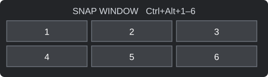

# Six Slot Snap

A small Windows desktop controller that places windows in a three-column,
two-row grid and keeps neighboring windows joined when you resize them.

Built with C#, Windows Forms, and Windows APIs. No external packages or
replacement taskbar. The current version is an early desktop utility tested
on Windows 11 with a 5120 × 2160 display at 125% scaling.

## Why it was made

An ultrawide desktop had enough room for six useful windows, but placing six
rectangles was only half the problem. Once they were arranged, resizing one
window needed to make its neighbors follow while preserving a usable grid.

The desired behavior was specific: three columns with two windows each;
connected left/right edges across neighboring columns; and a separate
top/bottom divider inside each column. Adjusting the middle column's row
height should not push the left and right columns' row dividers around.

This project grew from that everyday workflow through an iterative Codex
session: keyboard placement first, a visual selector next, then linked
resizing and recovery of all six occupied slots. It is shared so others can
reuse the result, inspect how it works, or use it as a starting point for
their own desktop tools.

**Codex helped build the project; it is not a runtime dependency.** The
controller runs locally without an AI service, API key, or network connection.

## Start

Download or clone this repository into a writable folder, then double-click
**Start.cmd**. The first launch compiles the source using the .NET Framework
C# compiler included on compatible Windows installations. The build produces
`bin/SixSlotSnap.exe`.

For a GitHub download, choose **Code → Download ZIP**, extract the ZIP, and
run `Start.cmd` from the extracted folder. Do not run it inside the ZIP.

Alternatively, in PowerShell from the project folder:

```powershell
.\Build.ps1 -Test
.\Start.ps1
```

No installation, administrator privileges, or automatic startup is required.
Only one instance runs in your Windows session. If an older copy is already
running, exit it from its tray icon before starting this copy.

`Start.cmd` uses a process-scoped PowerShell execution-policy argument for
the launcher; it does not change the machine's saved execution policy.
Managed machines may still restrict scripts or compilation.

## Snap a window

Select a window and press **Ctrl+Alt** with a number on the top number row:

| Left | Center | Right |
| --- | --- | --- |
| 1 | 2 | 3 |
| 4 | 5 | 6 |

Or hover over the small tab at the top center of the screen and click a cell.
The selector leaves the active window focused and collapses when unused.



## Resize the grid

- Drag a shared **left/right edge** to resize neighboring columns in both rows.
- Drag a shared **top/bottom edge** to resize that column's two windows.
- Each column keeps its own row divider. A horizontal boundary does not move
  the row dividers in other columns.
- Moving a window away releases its slot. Snap it again to reconnect it.

The controller saves proportions in `bin/layout.txt`. When it starts, it
reconnects windows already occupying the saved columns. Current complementary
top/bottom pairs take priority over stale saved row heights. If a window has
moved outside its slot, snap it back using the selector or shortcuts.

The tray menu can hide the selector, reset equal column widths and row heights,
or exit the controller. Exit and delete the project folder to remove it.

## Current limits

- One monitor is managed at a time; snapping on another monitor switches the
  active layout and clears the previous monitor's window assignments.
- Only the most recently snapped window in each slot participates in resizing.
- App minimum sizes may prevent an exact fit. Minimized and maximized neighbors
  are excluded from linked resizing.
- Elevated apps may require running the controller with matching privileges.
- The selector is a separate panel. This does not add a Windows Snap flyout
  layout or provide drag-to-zone snapping.
- App identities are not saved across app restarts. Recovery uses visible
  geometry, so overlapping duplicate windows may need manual reassignment.
- Full-screen apps, unusual window frames, and additional display configurations
  need broader testing.

## Development and verification

`src/SixSlotSnap.cs` contains the controller. Run `Build.ps1 -Test` to compile
the controller and run geometry regression tests without moving desktop windows.
The tests cover neighboring edges, independent row heights, corner resizing,
clamping, and layouts with nonzero monitor origins.

Manual integration checks performed during development used six test windows
and native move/size notifications. These checked middle-column edges from
both rows, all three row dividers, recovery with stale saved proportions, and
alignment after a delayed resize at mouse release. Those checks supplement
the portable geometry tests; they do not establish compatibility with every app.

Before reporting a resizing problem, include the app names, display scaling,
which edge was dragged, and the relevant lines from `bin/status.log`.

## Recreate or expand it with Codex

See [Using Codex](docs/USING-CODEX.md) for a recreation prompt, extension
examples, a validation workflow, and ideas for similar native desktop tools.
The repository also includes [AGENTS.md](AGENTS.md), which records the resizing
rules and build command for future coding sessions.

Some useful next steps are configurable shortcuts, per-monitor layouts,
minimum-size negotiation, saved app assignments, and an optional login launcher.
These are development ideas, not features already implemented.

## License and project notes

MIT licensed. See [LICENSE](LICENSE). You can reuse and modify the source
subject to the license terms.

This repository excludes local layout preferences, runtime logs, built
executables, and machine-specific helper scripts. See
[project notes](docs/PROJECT-NOTES.md) for architecture, lessons learned, and
the current verification limits. This is an independent project, not an
official Microsoft or OpenAI product.

